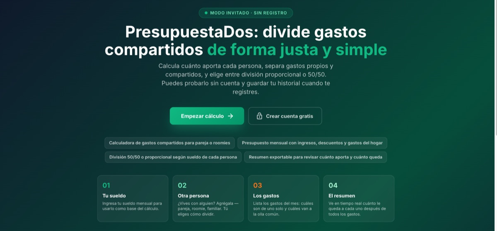
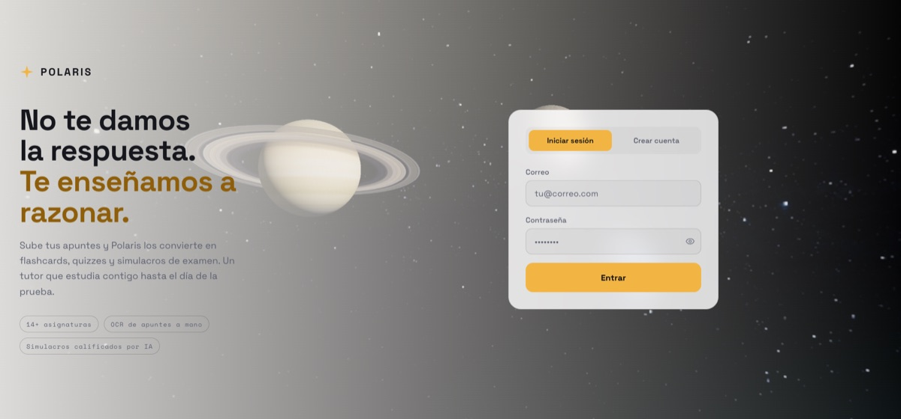

<picture>
  <source media="(prefers-color-scheme: dark)" srcset="assets/banner-dark.svg">
  
</picture>

  
  

Full-stack developer. I build web apps with TypeScript: React and Next.js on the front, and NestJS for almost every backend. On top of them I add AI features (RAG, OCR pipelines, LLM-generated content). I also build mobile apps with Flutter and data tooling with Python. Lately I've been building tools that make working with Claude Code easier to follow.

## Products

The code of these products is private. Happy to walk through it on request.

<table>
  <tr>
    <td width="50%" valign="top">
      
      <h3>PresupuestaDos · <a href="https://presupuestados.cl">presupuestados.cl</a></h3>
      
Shared expenses for couples and roommates, <b>live in production</b>. Income, expenses, deductions and budgets, monthly dashboards, spending projections, bank-statement import with AI and a guest mode without an account.

      
<b>React · Vite · MUI · NestJS · Drizzle · PostgreSQL · Redis · BullMQ · OpenAI</b>

    </td>
    <td width="50%" valign="top">
      
      <h3>Polaris · AI-assisted studying</h3>
      
Students upload their notes and get flashcards, quizzes, review schedules and answers grounded in their own material. <b>RAG</b>: OCR → chunking → embeddings in pgvector with an HNSW index, and every answer cites the excerpts it used.

      
<b>Next.js · Tailwind · NestJS · Drizzle · PostgreSQL + pgvector · Redis · BullMQ · S3 · OpenAI</b>

    </td>
  </tr>
</table>

<b>How PresupuestaDos and Polaris are built</b>

**PresupuestaDos**

- The browser never talks to the database. A NestJS API owns auth, shared accounts, budgets and the AI features, with rate limiting against abuse.
- AI reads bank statements and powers a financial assistant.
- Reports export to Excel and PDF.

**Polaris**

- Uploaded material goes through OCR, chunking and embeddings (`text-embedding-3-small`) in background jobs.
- Each question retrieves the closest chunks of that subject from pgvector (HNSW, cosine) and answers with cited excerpts. When nothing is indexed it says so instead of guessing.
- Flashcard reviews are scheduled with FSRS, a modern spaced-repetition algorithm.
- AI features are pluggable providers (OpenAI or mock) with per-user quotas, so the app can be tested without spending tokens.

### Ingenio en Familia · in development

A family web app of brain games and trivia in Chilean Spanish, built so that an 8-year-old and adults can compete fairly. Everyone plays with content and difficulty matched to their level, and rankings compare progress relative to each player's own level.

- Difficulty adapts per player and per game.
- Missed questions come back through spaced repetition, and every answer shows an explanation.
- Family members can challenge each other to asynchronous 1-vs-1 matches.
- Every AI-generated question goes through human review before a child sees it.

<b>Next.js · MUI · React Query · Zustand · React Three Fiber · NestJS · Drizzle · PostgreSQL · OpenAPI</b>

### More work

- **Storybook AI:** personalized children's stories in Spanish, with the text and an illustration for each story generated by OpenAI. Next.js, NestJS, Supabase.
- **Nailed It:** website for a manicure business, with services, gallery, testimonials, online booking and an admin panel. Vite, React, TypeScript.
- Websites and landing pages for small businesses.

## Open source

| Project | What it does |
| --- | --- |
| **[agent-board](https://github.com/PedroRozas/agent-board)** | A live board of every Claude Code session on your machine: subagents, current activity, context, cost and token usage. Web dashboard, docked pane and text views. |
| **[comparador-arriendo](https://github.com/PedroRozas/comparador-arriendo)** | Compare rental homes with a heatmap table, weighted ranking, radar charts and side-by-side comparison. React, TypeScript, MUI, Supabase. Bring your own Supabase project. |

## Stack

<picture>
  <source media="(prefers-color-scheme: dark)" srcset="https://skillicons.dev/icons?i=ts%2Cjs%2Creact%2Cnextjs%2Cvite%2Ctailwind%2Cmaterialui%2Cthreejs%2Cnestjs%2Cnodejs%2Cexpress%2Cpostgres%2Csupabase%2Credis%2Cpython%2Cflutter%2Cdart&perline=17&theme=dark">
  
</picture>

- **Backend:** NestJS (my default for APIs), Node.js, Express, REST and OpenAPI, JWT and cookie sessions, background jobs with BullMQ
- **Data:** PostgreSQL, pgvector, Supabase, Drizzle ORM, Redis
- **AI:** OpenAI, RAG (embeddings, vector search, cited answers), OCR pipelines, Claude Code
- **Frontend:** React, Next.js, Vite, MUI, Tailwind CSS, React Query, Zustand, React Three Fiber
- **Mobile:** Flutter
